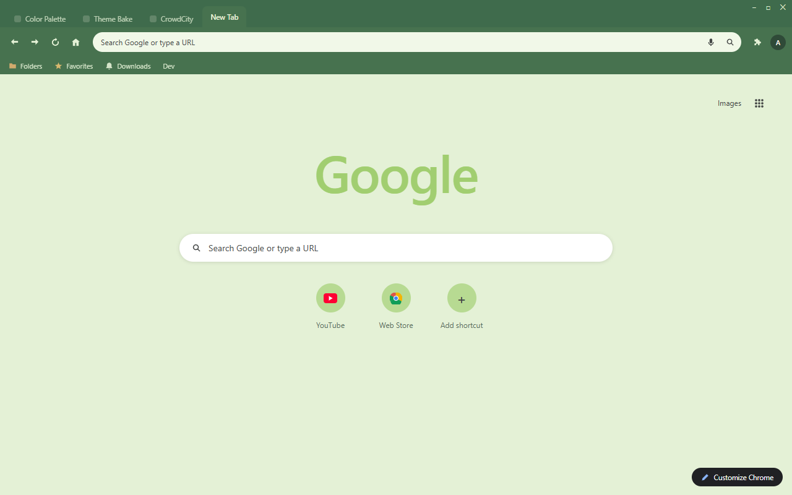
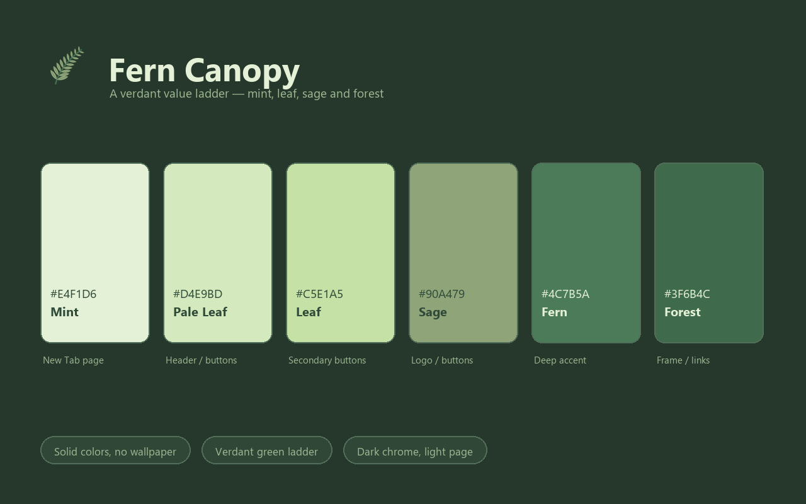

<p align="center">
  
</p>

<h1 align="center">Fern Canopy Theme</h1>

<p align="center">
  A lush green Chrome theme built on one verdant value ladder — pale mint leaves over a deep forest frame.
</p>

Fern Canopy pairs a forest-green frame with a slightly lighter green toolbar, then opens onto a soft mint New Tab Page. Cream ink keeps every tab, bookmark and toolbar icon crisp against the dark chrome, deep forest ink keeps the pale page readable, and a single-row shortcut layout with a color-matched Google logo keeps the New Tab Page clean.

<p align="center">
  
</p>

## Design Concept

Fern Canopy uses a single green hue pulled into five values — mint, pale leaf, leaf, sage and fern — plus one deeper forest tone for the chrome. Because every colour shares the same hue, the browser reads as one continuous material: a fern grove with light coming through the canopy. Contrast is carried by value rather than hue: the deepest greens take the frame and toolbar, the palest mint takes the page.

| Color | Hex | RGB | Role |
|---|---|---|---|
| Mint | `#E4F1D6` | 228, 241, 214 | New Tab background / cream ink |
| Pale Leaf | `#D4E9BD` | 212, 233, 189 | New Tab header / buttons |
| Leaf | `#C5E1A5` | 197, 225, 165 | Secondary buttons |
| Sage | `#90A479` | 144, 164, 121 | New Tab buttons / logo accent |
| Fern | `#4C7B5A` | 76, 123, 90 | Inactive frame |
| Forest | `#3F6B4C` | 63, 107, 76 | Frame / New Tab links |
| Toolbar Green | `#47724F` | 71, 114, 79 | Toolbar |
| Deep Forest Ink | `#2F4A38` | 47, 74, 56 | New Tab text |

## Features

- Pure color, no wallpaper — fast and distraction-free
- Single-hue verdant ladder: mint, leaf, sage and forest in one family
- Dark green chrome over a mint page — strong contrast, calm and leafy
- Tab text, bookmark text and toolbar icons all share the same mint-cream ink
- Single-row shortcut row and a color-matched Google logo for a clean New Tab Page
- No configuration needed — install and enjoy

## Preview

<p align="center">
  
</p>

<p align="center">
  
</p>

## Installation

### Load Unpacked (Development)

1. Download or clone this repository.
2. Open `chrome://extensions` in Chrome.
3. Enable "Developer mode" in the top right.
4. Click "Load unpacked" and select this folder (`fern-canopy-theme`).
5. The theme is now active.

### Web Store Packaging

```
chrome://extensions → Pack extension → select this folder → fern-canopy-theme.zip
```

Upload the resulting `.zip` to the Chrome Web Store developer dashboard.

## Files

| File | Purpose |
|---|---|
| `manifest.json` | Theme definition (single-file, inlined `theme` field) |
| `logo/logo.png` | 128×128 store icon (transparent background) |
| `store-assets/promo/440x280.png` | Small promo tile |
| `store-assets/promo/1400x560.png` | Marquee promo tile |
| `store-assets/screenshots/en/screenshot-1-browser.png` | Browser mockup screenshot (1280×800) |
| `store-assets/screenshots/en/screenshot-2-palette.png` | Palette introduction screenshot (1280×800) |
| `store-assets/store-description.txt` | Store listing description |
| `scripts/generate-logo-vector.py` | Render all SVG logo candidates with headless Chromium, build the contact sheets, and export `logo/logo.png` from the `SELECTED` candidate |
| `scripts/generate-screenshot-headless.py` | Regenerate the browser mockup via Playwright |
| `scripts/generate-screenshot-2-palette.py` | Regenerate the palette screenshot |
| `scripts/generate-promo.py` | Regenerate both promo tiles |
| `logo/candidates/` | Candidate previews and light/dark contact sheets |
| `LICENSE` | Non-Commercial License (English / 中文) |

## License

Fern Canopy Theme is released under the Non-Commercial License. See `LICENSE` for full text (English / 中文).
